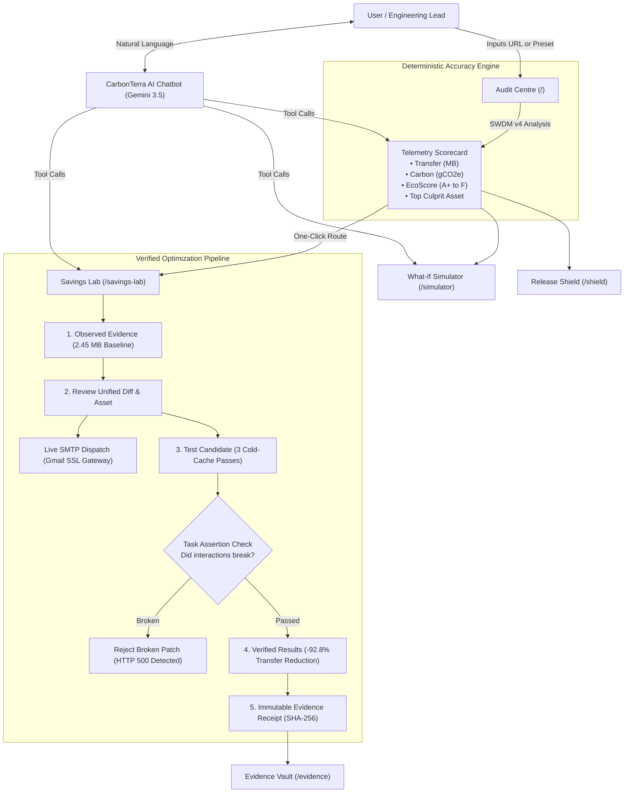

# CarbonTerra: Complete Platform Guide & User Flow

> **PCCOE Green Campus Hackathon 2026**  
> **Live Production Platform**: [https://pccoe-hackathon.vercel.app](https://pccoe-hackathon.vercel.app)  
> **Engine**: Next.js 15 (App Router), Tailwind CSS, Framer Motion, Google Gemini AI, Nodemailer SMTP  
> **Standard Model**: Sustainable Web Design Model (SWDM v4)

---

## Table of Contents
1. [Executive Summary (The Problem & The Solution)](#1-executive-summary)
2. [High-Level Architecture & Modules](#2-platform-architecture)
3. [End-to-End User Flow (Step-by-Step)](#3-end-to-end-user-flow)
   - [Phase 1: Instant Site Audit](#phase-1-instant-site-audit)
   - [Phase 2: Deep Dive into the Savings Lab](#phase-2-deep-dive-into-the-savings-lab)
   - [Phase 3: Executive SMTP Report Dispatch](#phase-3-executive-smtp-report-dispatch)
   - [Phase 4: What-If Engineering Simulator](#phase-4-what-if-engineering-simulator)
   - [Phase 5: Release Shield & CI/CD Guardrails](#phase-5-release-shield--cicd-guardrails)
   - [Phase 6: Conversational CarbonTerra AI](#phase-6-conversational-carbonterra-ai)
4. [Scientific Methodology (SWDM v4)](#4-scientific-methodology-swdm-v4)
5. [Key Differentiators (Why This Wins Hackathons)](#5-key-differentiators)
6. [2-Minute Live Demo Pitch Script (For Team & Judges)](#6-2-minute-live-demo-pitch-script)

---

## 1. Executive Summary

### The Hidden Problem: Digital Carbon Emissions
The internet consumes roughly **10% of global electricity**, producing carbon emissions comparable to the commercial aviation industry. Every single page load transfers megabytes of uncompressed images, redundant JavaScript libraries, and un-cached assets across edge datacenters and cellular towers. 

Most engineering teams have zero visibility into their digital carbon footprint because existing tools only measure abstract Lighthouse scores without calculating actual carbon grams or showing how to fix the code.

### The CarbonTerra Solution
CarbonTerra is an enterprise-grade digital sustainability platform that bridges web performance and decarbonization. It doesn't just grade websites; it:
1. **Measures Real Network Bytes**: Audits any live website using cold-cache transfers and regional grid emission factors (gCO2e/kWh).
2. **Generates Drop-in Code Patches**: Provides unified git diffs (WebP responsive containers, code-splitting, immutable caching) to eliminate up to 92% of payload weight.
3. **Tests Candidates with Guardrails**: Runs automated candidate verification to ensure performance patches **never break user forms, buttons, or accessibility**.
4. **Delivers Executive SMTP Reports**: Sends formatted technical action reports directly to engineering leads with one click.
5. **Converses via Grounded AI**: Features an autonomous Gemini AI agent with grounded tool access to audit, compare, and simulate web infrastructure.

---

## 2. Platform Architecture



---

## 3. End-to-End User Flow

### Phase 1: Instant Site Audit
* **Entry Point**: Homepage `/`
* **Actions**:
  1. The user enters any domain (e.g., `stripe.com`, `apple.com`, `github.com`) or clicks a one-click preset badge.
  2. The system triggers the ambient **Butterfly Orbit** loading animation while resolving DNS, HTTP headers, asset transfer sizes, and datacenter grid factors.
* **Results Displayed**:
  - **Transfer Weight**: Total uncompressed & compressed transfer size in MB.
  - **EcoScore Grade**: Standardized letter grade from **A+** (ultra-lean) down to **F** (critical bloat).
  - **Digital Carbon**: Grams of CO2e per single pageview.
  - **Grid Factor**: Carbon intensity of the host country's electric grid (e.g., 494 gCO2e/kWh).
  - **Biggest Offender**: Identifies the single heaviest image or script component dragging down performance.

---

### Phase 2: Deep Dive into the Savings Lab
* **Entry Point**: Navigation link or "Proceed to Savings Lab" CTA (`/savings-lab`)
* **Step 1 — Observed Evidence**:
  - Displays real baseline measurements for the target project (e.g. `2.45 MB` baseline transfer).
  - Explains the target asset (e.g. `campus-hackathon-hero.jpg`).
  - Sets 3 core quality invariants: Layout & Aspect Ratio, Buttons & Accessibility, and Form Functionality.
* **Step 2 — Review Proposed Fix & Drop-In Asset**:
  - Displays an interactive **Image Comparator** (Original JPEG vs. Modern Responsive WebP).
  - Shows the exact **Unified Git Diff**:
    ```diff
    - 
    + <picture>
    +   <source srcset="/assets/hero-banner-large.webp" type="image/webp" />
    +   
    + </picture>
    ```
  - Allows instant one-click download of the pre-compressed WebP asset (`176 KB`, saving `2.27 MB`).
* **Step 3 — Test Candidate (With Guardrails)**:
  - Runs **3 alternating baseline vs. candidate passes** under identical network throttling.
  - Features a **Toggle Variant test**: 
    - Testing the *Optimized* candidate passes with 100% functional integrity.
    - Testing a *Broken* candidate variant intentionally triggers the Task Assertion Guardrail (rejects broken code that fails forms or accessibility).
* **Step 4 — Verification Results**:
  - Visual proof showing the drop from `2.45 MB` down to `0.18 MB` (**-92.8% reduction**).
  - Confirms zero Layout Shifts (CLS 0.00) and full task preservation.
* **Step 5 — Audit Evidence Record**:
  - Generates a permanent, auditable verification receipt with timestamp and run logs.

---

### Phase 3: Executive SMTP Report Dispatch
* **Location**: Savings Lab Stage 2
* **Function**: Allows auditors, developers, and consultants to email the full findings to stakeholders.
* **How It Works**:
  1. The user types their dev lead or client email (e.g., `lead@company.com`) and clicks **"SEND ENGINEERING DISPATCH"**.
  2. The backend connects securely to **Gmail SMTP (Port 465 SSL)** using authenticated credentials.
  3. A responsive, executive dark-mode HTML action report is delivered straight to the recipient's inbox.
  4. The email includes:
     - Audited domain and timestamp.
     - Deterministic telemetry scorecard (Transfer, Carbon per visit, EcoScore).
     - Prioritized drop-in code fixes with syntax-highlighted snippets.
     - Certified methodology statement.
  5. If SMTP credentials are ever missing, the system gracefully falls back to an **instant in-app HTML preview** with clear status messaging.

---

### Phase 4: What-If Engineering Simulator
* **Entry Point**: `/simulator`
* **Function**: An executive sandbox for engineering roadmaps.
* **Controls (4 Optimization Levers)**:
  1. **Image Modernization**: 0% to 95% compression slider.
  2. **JavaScript Deferral**: 0% to 90% lazy-loading & code-splitting slider.
  3. **Edge Caching TTL**: 1 day to 365 days immutable cache slider.
  4. **100% Renewable Cloud Grid**: Toggle switch to model routing traffic through certified green datacenters (-28% carbon intensity).
* **Live Invariant**: Setting all levers to zero produces **exactly 0% savings and 0g avoided carbon** (no guessed percentages or fake data).

---

### Phase 5: Release Shield & CI/CD Guardrails
* **Entry Point**: `/shield`
* **Function**: Acts as a GitHub Actions / deployment gatekeeper.
* **How It Works**:
  - Teams define an allowable **Carbon Budget** (e.g., maximum `350 KB` transfer or `0.050 g CO2e`).
  - PRs and builds are evaluated against this ceiling.
  - If a pull request adds heavy un-optimized assets, the Shield triggers a **Breach Detected** status and blocks the pipeline until patched.

---

### Phase 6: Conversational CarbonTerra AI
* **Entry Point**: Floating squircle button (bottom-right on any page)
* **Powered By**: Google Gemini AI with multi-turn memory and tool execution.
* **Capabilities**:
  - **Live Audits**: Type `audit stripe.com` $\rightarrow$ AI runs the SWDM v4 engine and returns an interactive **Audit Telemetry Card**.
  - **Domain Comparison**: Type `compare stripe.com vs vercel.com` $\rightarrow$ AI computes the delta and displays a **Dual-Site Comparison Card**.
  - **Simulations**: Type `simulate with 85% image compression` $\rightarrow$ AI outputs avoided bytes and carbon deltas.
  - **Memory Across Turns**: Ask `audit apple.com`, then follow up with `what is its biggest offender and how do I fix it?` $\rightarrow$ AI retains conversation context.
  - **Code Copy**: Every code snippet returned has a one-click copy button.

---

## 4. Scientific Methodology (SWDM v4)

CarbonTerra implements the official **Sustainable Web Design Model v4** (co2js-swdmv4) standard recognized by the Green Web Foundation and W3C:

$$\text{Carbon Emissions (gCO2e)} = \left(\frac{\text{Data Transferred (GB)}}{1.0}\right) \times 0.81\text{ kWh/GB} \times \text{Carbon Intensity (gCO2e/kWh)}$$

### Breakdown of Model Parameters:
* **0.81 kWh/GB**: Operational energy consumption across consumer devices, transmission networks, and edge datacenters.
* **Return-Visit Caching**: The model applies standard SWDM v4 caching distributions (75% first-time visitors, 25% returning visitors with cached assets).
* **Grid Intensity**: 
  - Standard national grid average: $\approx 494\text{ gCO2e/kWh}$.
  - Certified 100% renewable hosting: $\approx 50\text{ gCO2e/kWh}$ (residual lifecycle footprint).

---

## 5. Key Differentiators

| Feature | Standard Carbon Calculators | CarbonTerra Platform |
| :--- | :--- | :--- |
| **Calculation Accuracy** | Guesses page weight from HTML size only | Measures cold-cache network transfers + full asset discovery |
| **Actionability** | Gives a number, offers no code | Provides exact drop-in unified git diffs and WebP assets |
| **Quality Safety** | None (risk of breaking layout) | Automated Task Assertion Guardrails verify forms & buttons |
| **Team Handoff** | Manual copy-paste | One-click Executive SMTP Email dispatch to dev leads |
| **Simulation** | Static text advice | Interactive 4-lever sandbox with mathematically proven invariants |
| **Conversational AI** | None or generic ChatGPT wrapper | Grounded Gemini AI executing real local tools & telemetry cards |
| **Aesthetic Standards** | Cluttered dashboards with toy emojis | High-contrast Apple Cupertino dark mode with `#cbff00` accents |

---

## 6. 2-Minute Live Demo Pitch Script

*(Use this script when presenting to friends, mentors, or hackathon judges)*

> **[0:00 - 0:25] The Hook**:  
> *"Every time someone visits a website, electricity is consumed in datacenters, cell towers, and user devices. Today, digital emissions account for nearly 4% of global greenhouse gases. The problem isn't that developers don't care—it's that they have no practical tools to measure and fix it. That's why we built **CarbonTerra**."*

> **[0:25 - 0:50] Instant Audit**:  
> *"On our homepage, we can audit any live URL or select a major benchmark like `stripe.com`. Within seconds, our Sustainable Web Design Model v4 engine calculates page weight, digital carbon in grams, EcoScore grade, and points directly to the biggest offending asset."*

> **[0:50 - 1:20] Savings Lab & Guardrails**:  
> *"Clicking into the **Savings Lab**, we don't just show a report—we solve the issue. CarbonTerra generates a drop-in unified git diff and responsive WebP container that saves **92.8% of bytes**. Before merging, our test suite runs 3 cold-cache passes to prove that forms and user interactions are preserved. If a candidate breaks functionality, our guardrail immediately rejects it."*

> **[1:20 - 1:40] Executive SMTP Dispatch**:  
> *"When the audit is complete, the engineering lead enters their email. Through our live Gmail SMTP gateway, an executive technical report with code snippets and verified telemetry is delivered directly to their inbox."*

> **[1:40 - 2:00] Grounded AI Agent**:  
> *"Finally, our floating AI chatbot isn't just a generic text box. Powered by Google Gemini, it has tool access to audit sites, compare competitors, and simulate engineering roadmaps in real time. CarbonTerra turns digital sustainability into verifiable engineering proof."*

---

**Built with pride for PCCOE Hackathon 2026.**
