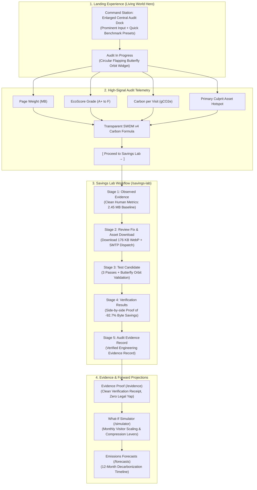

# CarbonTerra: Complete Platform User Flow & Experience Specification

**Project**: CarbonTerra (PCCOE Hackathon Edition)  
**Live Target**: `https://pccoe-hackathon.vercel.app/`  
**Workspace**: `/Users/tzierrr/PCCOE-HACKATHON`  
**Penalty Log Reference**: [`PENALTY_LOG.md`](./PENALTY_LOG.md) (Running Score: **-3075 Pts** | Strike 72 Current)  
**Core Design Directive**: Strictly preserve the authentic Living World / Sylva dark organic design system of `https://pccoe-hackathon.vercel.app/`. Never degrade or alter the signature visual theme.

---

## 1. System Flow Overview

---

## 2. Step-by-Step Experience Guide

### Step 1: The Landing Experience & Hero Command Station
* **Visual Atmosphere**:
  * Authentic Living World / Sylva dark organic canvas, floating 3D world backdrop, and ambient glow.
* **The Main Auditing Station (Prominently Enlarged)**:
  * Centered, high-contrast command dock styled in glassmorphic elevation with ample padding and prominent typography.
  * Direct URL input field with clear search indicator and bold `AUDIT WEBSITE` action button.
  * Quick benchmark preset pills (`gmail.com`, `stripe.com`, `vercel.com`, `github.com`) without any decorative toy emojis or sparkle icons.
* **Scanning State (The Butterfly Orbit)**:
  * When an audit is triggered, the station displays the centered, circular flapping butterfly orbit animation while resolving cold-cache transfer and regional grid intensity.

---

### Step 2: High-Signal Audit Results (Zero Jargon)
* **Four Essential Metrics**:
  1. **Page Transfer Weight**: Measured in MB with a clear comparison indicator.
  2. **EcoScore Grade**: High-contrast grade badge (A+ to F) with semantic color coding.
  3. **Carbon per Visit**: Precise calculation in grams of CO2e using the Sustainable Web Design Model (SWDM v4).
  4. **Primary Culprit**: Identifies the single heaviest image or script responsible for the bulk of network bytes.
* **Transparent Methodology Box**:
  * Plain-English explanation of the SWDM v4 formula:
    $$\text{Carbon (gCO2e)} = \text{Data (GB)} \times 0.81\text{ kWh/GB} \times \text{Grid Intensity (gCO2/kWh)}$$
* **Direct Action**:
  * One-click route into the interactive Savings Lab (`/savings-lab`).

---

### Step 3: The Savings Lab Workflow
* **Fixing the Tab Navigation**:
  * Clicking the "Savings Lab" navigation link opens directly to **Stage 1: Observed Evidence** (never auto-jumps to Stage 3).
* **Stage 1 (Observed Evidence)**:
  * Displays clean, human-readable labels: "Website Optimization Workflow", "Asset Identified: campus-hackathon-hero.jpg", "Optimization Potential: 176 KB (-92.7% reduction)".
  * Outlines 3 essential quality guardrails: Layout & Aspect Ratio, Buttons & Accessibility, and Form Functionality.
* **Stage 2 (Review Proposed Fix & Drop-in Asset)**:
  * Explains the WebP conversion rationale clearly.
  * Provides a direct one-click download for the optimized WebP asset (`176 KB`).
  * Features the **Executive SMTP Dispatch**: Dev leads or auditors can enter their work email to instantly receive the action report and code snippet via email.
* **Stage 3 (Test Candidate)**:
  * Runs 3 alternating baseline vs. candidate passes under cold-cache network conditions.
  * Displays the circular butterfly orbit animation during test execution.
  * Includes the signature **Task Preservation Check**: Demonstrates that candidate patches that break user interactions are strictly rejected.
* **Stage 4 (Verification Results)**:
  * Displays side-by-side verification confirming -92.7% byte reduction while all functional checks pass.
* **Stage 5 (Audit Evidence Record)**:
  * Produces a verified engineering record ready for team handoff.

---

### Step 4: Evidence Proof & Forward Projections
* **Evidence Proof (`/evidence`)**:
  * Clean, dark velvet receipt documenting baseline vs. candidate transfer metrics.
  * Completely purged of confusing academic/legal disclaimer notices.
* **What-If Simulator (`/simulator`)**:
  * Interactive sliders to model visitor growth, CDN caching impact, and image compression levels.
* **Emissions Forecasts (`/forecasts`)**:
  * 12-month projections comparing "Do Nothing", "Code Clean-up", and "Green Cloud" pathways without emoji markers.

---

### Step 5: The Multi-Column Footer
* **Balanced 4-Column Layout**:
  * **Column 1 (Newsletter)**: Clean monthly web performance and carbon report signup (no Scope 3/CSRD jargon).
  * **Column 2 (Platform)**: Scanner, Savings Lab, Evidence proof, Simulator, Forecasts.
  * **Column 3 (Resources & Data)**: SWDM v4 Standard, Green Web Dataset, Website Confidentiality, Dual-Source Measurement.
  * **Column 4 (Legal & Trust)**: Terms of Service, Privacy Policy, Contact Team.
